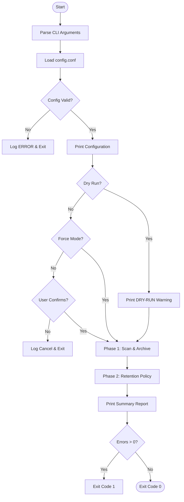
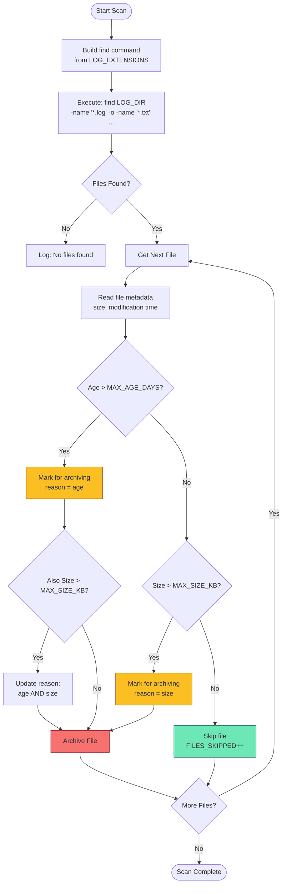
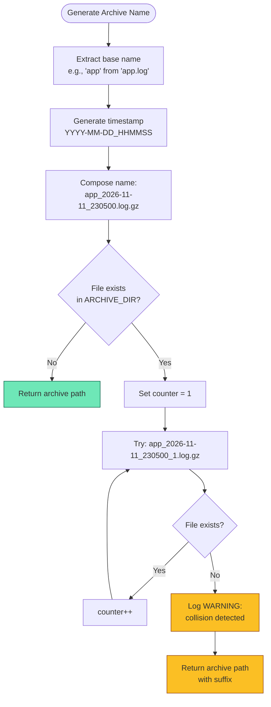
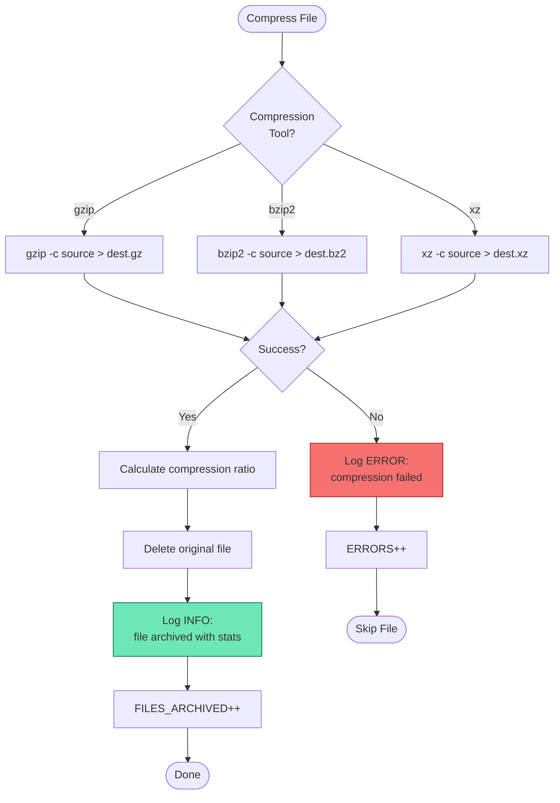
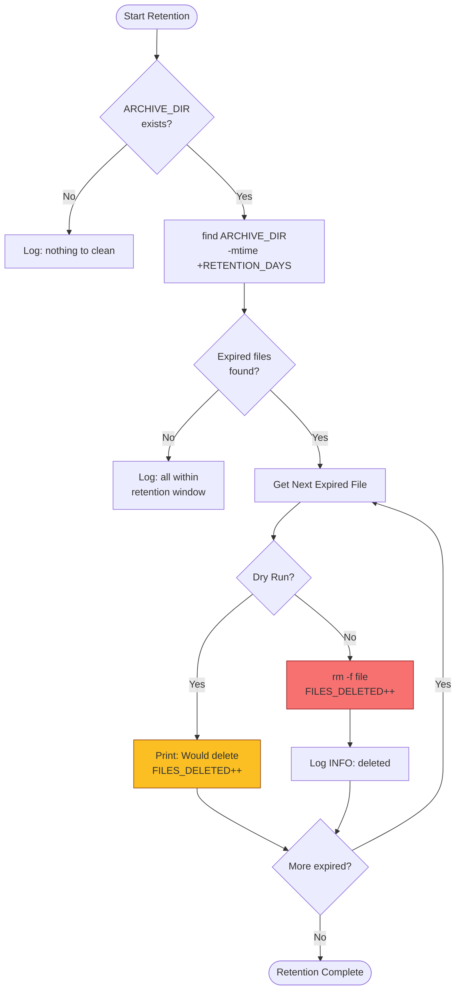
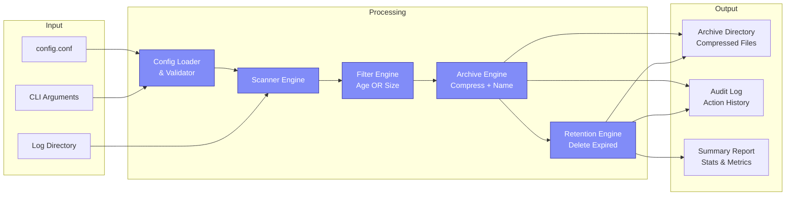
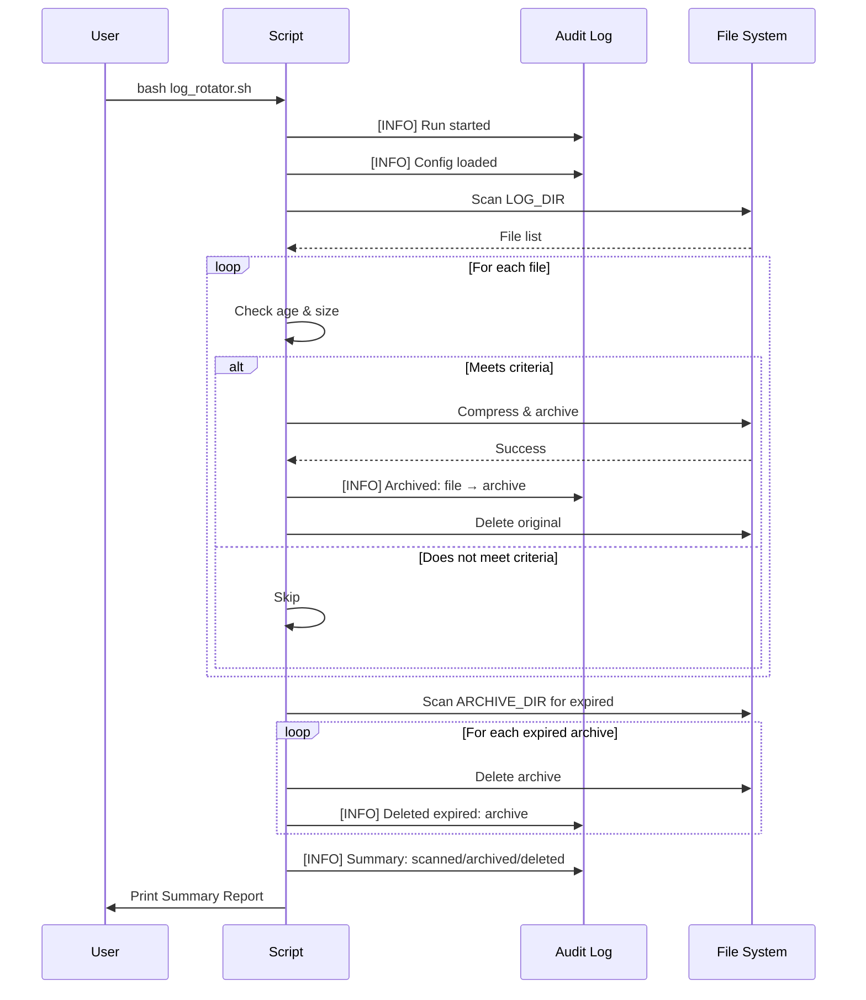

# Flowcharts — Automated Log Archive & Rotation

Visual representations of the algorithms used in the log rotation utility.

---

## 1. Main Execution Flow

---

## 2. File Scanning & Filtering Algorithm

---

## 3. Archive Name Generation & Overwrite Protection

---

## 4. Compression Workflow

---

## 5. Retention Policy Enforcement

---

## 6. Complete System Overview

---

## 7. Audit Log Event Flow

